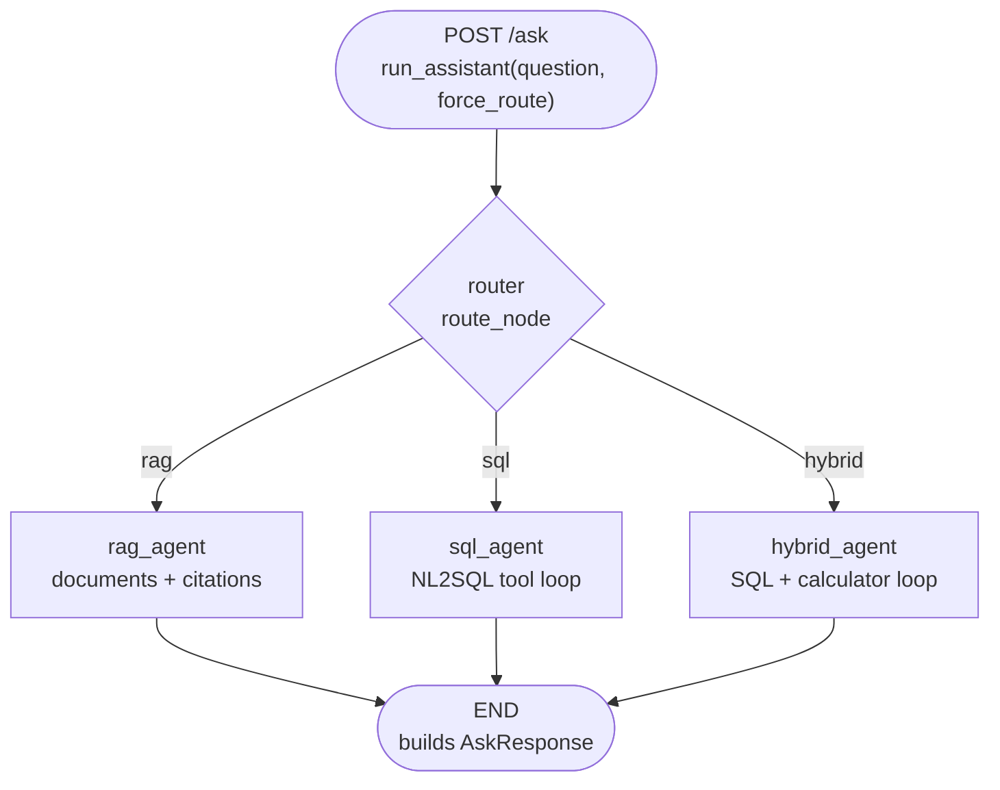
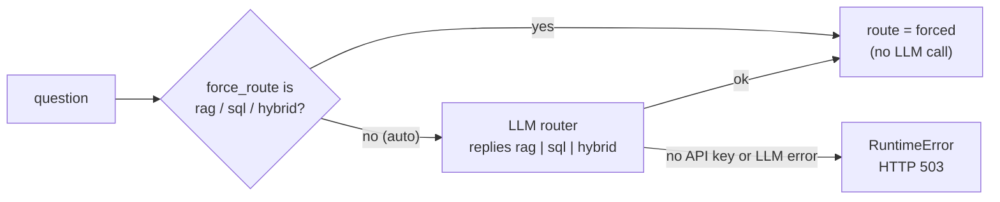
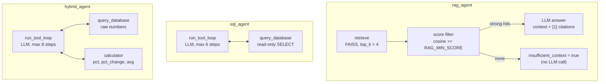

# Adan Retail AI Assistant

نمونهٔ عملی یک دستیار داخلی برای فروشگاه فرضی **Adan Retail** با سه قابلیت اصلی:

1. **RAG** روی اسناد PDF (سیاست بازگشت، handbook کارکنان، کاتالوگ)
2. **NL2SQL** روی SQLite با جداول مرتبط `products` و `sales`
3. **Agentic flow** با LangGraph: Coordinator + Sub-Agentهای RAG/SQL/Hybrid + ابزار **Calculator** از طریق **Tool Calling**

تمرکز روی کارکرد صحیح، امنیت SQL خواندنی، و قابل‌اجرا بودن با Docker است — نه Production کامل.

---

## Architecture

### 1. Coordinator graph (LangGraph)

یک router و سه نود تخصصی؛ هر سه نود مستقیم به `END` می‌روند و سطح گراف حلقه ندارد
(کد: `app/agents/coordinator.py`).



### 2. How the router decides



There is no keyword fallback: a wrong guess would silently return an irrelevant answer,
so a missing key or a failed router call is reported as an error instead.

### 3. Inside each agent



`sql_agent` و `hybrid_agent` هر دو یک حلقهٔ tool calling مشترک (`app/agents/tool_agent.py`) دارند:
LLM ابزار را صدا می‌زند، نتیجه (یا خطا) را می‌بیند، در صورت نیاز دوباره تلاش می‌کند، و در پایان پاسخ می‌دهد.
تعداد مرحله‌ها محدود است (`SQL_AGENT_MAX_STEPS`, `HYBRID_AGENT_MAX_STEPS`).

| Layer | Choice |
| --- | --- |
| API | FastAPI |
| Orchestration | LangGraph (router) + tool-calling loop (`bind_tools`) |
| Vector store | FAISS |
| Embeddings | `sentence-transformers/all-MiniLM-L6-v2` (local) |
| LLM | OpenAI or Gemini (both through `ChatOpenAI`; model **must support tool calling**) |
| DB | SQLite (`products`, `sales`) |
| PDF prep | pypdf + preprocessing (header/footer strip, hyphen fix, unicode NFKC, chunking) |

---

## Quick start (Docker)

```bash
cp .env.example .env
# set OPENAI_API_KEY (or LLM_PROVIDER=gemini + GEMINI_API_KEY) in .env

docker compose up --build
```

API: [http://localhost:8000](http://localhost:8000)  
Docs: [http://localhost:8000/docs](http://localhost:8000/docs)  
UI (optional Gradio): [http://localhost:7860](http://localhost:7860)

Entry point will:

1. Seed SQLite
2. Build FAISS index (first boot downloads the embedding model)
3. Start Uvicorn on port `8000`

Sample PDFs are already under `data/documents/`.

### Model / API configuration

| Variable | Purpose |
| --- | --- |
| `LLM_PROVIDER` | `openai` (default) or `gemini` |
| `OPENAI_API_KEY` | Key for OpenAI / OpenAI-compatible gateway |
| `OPENAI_BASE_URL` | Optional OpenAI-compatible base URL |
| `GEMINI_API_KEY` | Key for Gemini (uses Google's OpenAI-compatible endpoint) |
| `LLM_MODEL` | e.g. `gpt-4o-mini` or a Gemini model name — must support tool calling |
| `LLM_TIMEOUT`, `LLM_MAX_RETRIES` | Per-request timeout / automatic retries |
| `EMBEDDING_MODEL` | Default MiniLM (no API key) |
| `RAG_MIN_SCORE` | Cosine-similarity threshold (see below) |
| `SQL_MAX_ROWS`, `SQL_TIMEOUT_SECONDS` | Row cap and time limit for each query |

---

## Local development (without Docker)

```bash
python -m venv .venv
# Windows: .venv\Scripts\activate
# Linux/macOS: source .venv/bin/activate
pip install -r requirements.txt
cp .env.example .env   # add your API key

python scripts/init_db.py
python scripts/build_index.py
uvicorn app.main:app --reload --port 8000
```

### Changing the documents

The FAISS index is built from `data/documents/*.pdf` by `scripts/build_index.py`
(Docker runs it on every container start). After adding or editing a PDF, re-run:

```bash
python scripts/build_index.py
```

and restart the API (it keeps the index in memory).

---

## Example requests

```bash
# Health
curl http://localhost:8000/health

# RAG
curl -s http://localhost:8000/ask -H "Content-Type: application/json" ^
  -d "{\"question\":\"How many days do customers have to return unused products?\"}"

# NL2SQL (aggregation)
curl -s http://localhost:8000/ask -H "Content-Type: application/json" ^
  -d "{\"question\":\"What is the total revenue from all sales?\",\"force_route\":\"sql\"}"

# NL2SQL (filter + join)
curl -s http://localhost:8000/ask -H "Content-Type: application/json" ^
  -d "{\"question\":\"Show total revenue by category for sales in Tehran\",\"force_route\":\"sql\"}"

# Hybrid: SQL then calculator (tool calling)
curl -s http://localhost:8000/ask -H "Content-Type: application/json" ^
  -d "{\"question\":\"What is the total sales revenue and calculate 15 percent of that amount?\",\"force_route\":\"hybrid\"}"

# Hybrid, multi-query: two SQL calls, then a percent-change calculation
curl -s http://localhost:8000/ask -H "Content-Type: application/json" ^
  -d "{\"question\":\"How much more percent revenue did Tehran make than Isfahan?\",\"force_route\":\"hybrid\"}"

# Out-of-scope document question
curl -s http://localhost:8000/ask -H "Content-Type: application/json" ^
  -d "{\"question\":\"What is the CEO private phone number?\",\"force_route\":\"rag\"}"

# Dangerous SQL (blocked, no LLM involved)
curl -s -X POST "http://localhost:8000/sql/validate?sql=DROP%20TABLE%20products"
```

More examples: [`examples/sample_requests.md`](examples/sample_requests.md)  
Illustrative outputs: [`examples/sample_outputs.json`](examples/sample_outputs.json)

Each `/ask` response includes `route`, `trace` (which sub-agent/tool ran, in order),
`tool_calls` (every tool call the LLM made with its arguments and result), optional
`sql` / `sql_result`, `sources`, and `calculator`.

---

## Demo scenarios (evaluation checklist)

| # | Type | Sample question | Expected behavior |
| --- | --- | --- | --- |
| 1 | RAG | Return window for unused products? | ~30 days + citation `return_policy.pdf` |
| 2 | RAG | Annual leave days for full-time staff? | 18 days + `employee_handbook.pdf` |
| 3 | RAG OOS | CEO salary / private phone? | `insufficient_context=true`, no hallucination |
| 4 | NL2SQL | Total sales revenue? | `SUM(quantity * unit_price)` + rows |
| 5 | NL2SQL | Revenue by category in Tehran? | JOIN + GROUP BY + filter |
| 6 | Hybrid | Total revenue and 15% of it? | `query_database` → `calculator` in `trace` / `tool_calls` |
| 7 | Hybrid | Tehran vs Isfahan revenue, percent difference? | 2× `query_database` → `calculator` (`pct_change`) |
| 8 | SQL safety | `DROP TABLE products` | Rejected by validator |
| 9 | SQL self-repair | Query with a wrong column | Error returned to LLM → corrected query (see `tests/test_tool_agent.py`) |

---

## SQL safety

LLM-generated SQL passes through several independent layers (any one of them stops a write):

1. **Validator** (`validate_readonly_sql`): single statement, `SELECT`/`WITH` only, DDL/DML keywords blocked
   (string literals and comments are ignored, so `LIKE '%update%'` and `REPLACE()` are fine).
2. **Read-only connection**: the SQLite file is opened with `mode=ro` and `PRAGMA query_only=ON`.
3. **Authorizer** (`set_authorizer`): only `SELECT`, function calls, and reads of `products`/`sales` are allowed;
   `sqlite_master`, `ATTACH`, `PRAGMA`, writes are denied by SQLite itself.
4. **Time limit** (`SQL_TIMEOUT_SECONDS`) and **row cap** (`SQL_MAX_ROWS`).

Errors are returned to the LLM as tool results, so it can fix its own query (bounded by the step limit).

---

## RAG score and "not enough information"

FAISS returns squared L2 distance; embeddings are normalized, so the code converts it to
**cosine similarity** (`1 - d/2`). Chunks below `RAG_MIN_SCORE` are ignored; if none remain the
API answers with `insufficient_context=true` without calling the LLM.

The best threshold depends on your documents and embedding model. Calibrate it:

```bash
python scripts/check_rag_threshold.py
```

---

## Tests

```bash
pytest -q
```

Covered without needing an API key (the LLM is replaced by a scripted fake):

- calculator safety and helpers
- SQL validation, read-only connection, authorizer, timeout, row cap
- tool-calling agents: SQL → answer, SQL error → retry, SQL → calculator, multi-query hybrid, step limit
- end-to-end `/ask` response fields for the hybrid route
- document preprocessing & chunking
- coordinator routing (LLM router, forced route, error when no key / LLM failure)

---

## Project layout

```
app/
  main.py                 # FastAPI
  llm.py                  # one place to build the chat model (OpenAI / Gemini)
  agents/
    coordinator.py        # LangGraph router + nodes
    tool_agent.py         # shared tool-calling loop (bind_tools, retries, step limit)
    sql_agent.py          # query_database tool
    hybrid_agent.py       # query_database + calculator tools
    rag_agent.py
  rag/                    # preprocess, ingest (FAISS), retrieve+answer
  sql/                    # schema/seed, read-only connection, validation/execution
  tools/
    calculator.py         # AST-based safe calculator (+ LangChain tool)
    database.py           # query_database LangChain tool
  models/schemas.py
data/documents/           # sample PDFs
scripts/                  # init_db, build_index, check_rag_threshold, entrypoint
tests/
examples/
Dockerfile
docker-compose.yml
.env.example
```

---

## Limitations

- Not production-hardened (no auth, rate limits, multi-tenant isolation); `/sql/validate` is a demo endpoint.
- The configured model must support tool calling; answer quality depends on the model.
- The router makes one LLM call and does not re-route after an agent finishes. Without an API key (or if that call fails) `/ask` returns 503, unless `force_route` is set and the chosen agent can run without an LLM.
- English embeddings (MiniLM): non-English questions over English PDFs retrieve poorly.
- SQLite sample is small and static; rebuild with `python scripts/init_db.py`.
- The FAISS index is not rebuilt automatically when PDFs change (see "Changing the documents").

---

## License

Prepared as an evaluation sample for Adan RAG assignment.
