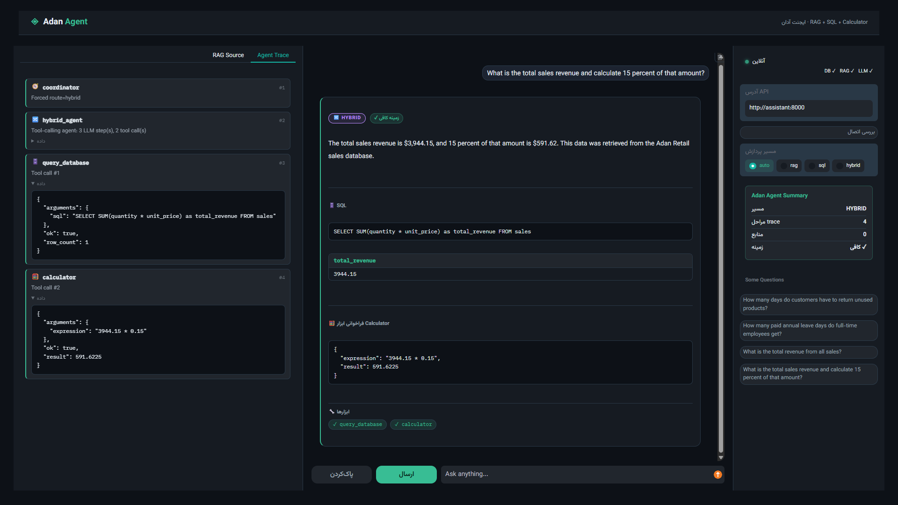
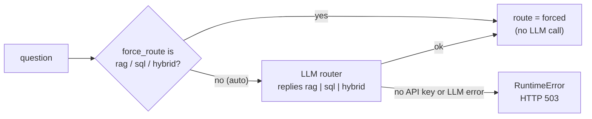
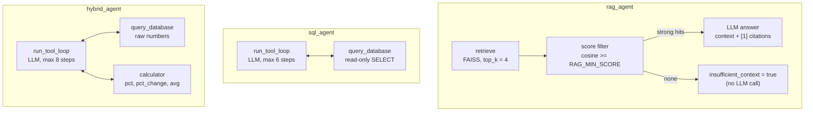

<div align="center">

# Adan AI Assistant

**A multi-agent assistant that answers questions from documents (RAG), a SQL database (NL2SQL), or both, and does the math with a safe calculator tool.**

</div>

<!--
  DEMO VIDEO (see the "Demo" section below)
  Easiest way: open this file in GitHub's web editor (pencil icon), drag your .mp4
  into the editor, and GitHub inserts a https://github.com/user-attachments/... link.
  Put that link on its own line right under the "Demo" heading and it renders as a player.
-->

---

## Table of contents

- [Overview](#overview)
- [Demo](#demo)
- [Features](#features)
- [Architecture](#architecture)
- [Tech stack](#tech-stack)
- [**Quick start**](#quick-start)
- [Configuration](#configuration)
- [User interface](#user-interface)
- [API reference](#api-reference)
- [**Example requests**](#example-scenarios)
- [SQL safety](#sql-safety)
- [RAG scoring](#rag-scoring)
- [Tests](#tests)
- [Project layout](#project-layout)
- [License](#license)

---



## Overview

<div dir="rtl">

**دستیار هوش مصنوعی آدان** یک دستیار داخلی برای فروشگاه فرضی **Adan Shop** است. کارمند فقط سؤال خود را می‌نویسد و سیستم خودش تشخیص می‌دهد پاسخ را باید از کجا بیاورد:

1. **اسناد شرکت (RAG):** شامل اسنادی در زمینه سیاست بازگشت کالا، راهنمای کارکنان و کاتالوگ محصولات  
2. **پایگاه‌داده (NL2SQL):** سؤال طبیعی به SQL امن و فقط‌خواندنی روی جداول `products` و `sales` تبدیل می‌شود
3. **ترکیب هر دو + محاسبه (Hybrid):** مثلاً «کل درآمد را بگیر و ۱۵٪ آن را حساب کن»؛ مدل با **Tool Calling** اول SQL و سپس ماشین‌حساب را صدا می‌زند

</div>

| Route | Typical question | What happens |
| --- | --- | --- |
| `rag` | *How many days do customers have to return unused products?* | Retrieves PDF chunks, answers with `[1]` citations |
| `sql` | *Show total revenue by category for sales in Tehran* | LLM writes a read-only `SELECT`, runs it, explains the rows |
| `hybrid` | *How much more percent revenue did Tehran make than Isfahan?* | Two SQL calls, then `pct_change` in the calculator |

---

## Demo

<!-- Paste the uploaded video link on the next line (a bare github.com/user-attachments/... URL). -->

<!-- Optional screenshot: save it as docs/images/ui.png and uncomment the next line.

-->

---

## Features

- **Automatic routing:** an LLM router picks `rag`, `sql` or `hybrid`; you can also force a route.
- **Grounded answers:** RAG answers cite their source document and page; if retrieval is weak the API says so (`insufficient_context=true`) instead of guessing.
- **Safe NL2SQL:** four independent layers (validator, read-only connection, SQLite authorizer, time and row limits). See [SQL safety](#sql-safety).
- **Real tool calling:** `query_database` and `calculator` are LangChain tools; the LLM sees tool errors and can repair its own query (bounded by a step limit).
- **Full transparency:** every response includes the ordered `trace`, every `tool_calls` record, the generated `sql`, its result and the `sources`.
- **Web UI:** Persian (RTL) Gradio interface with agent trace, sources, SQL result tables and a live health indicator.
- **One command to run:** Docker Compose seeds the database, builds the vector index and starts both the API and the UI.

---

## Architecture

### 1. Coordinator graph (LangGraph)


### 2. How the router decides




### 3. Inside each agent




---

## Tech stack

| Layer | Choice |
| --- | --- |
| API | FastAPI |
| Orchestration | LangGraph (router) + tool-calling loop (`bind_tools`) |
| Vector store | FAISS |
| Embeddings | `sentence-transformers/all-MiniLM-L6-v2` (local, no API key) |
| LLM | OpenAI or Gemini, both through `ChatOpenAI`; the model **must support tool calling** |
| Database | SQLite (`products`, `sales`) |
| PDF preparation | pypdf + preprocessing (header/footer strip, hyphen fix, Unicode NFKC, chunking) |
| UI | Gradio (RTL, dark theme) |
| Deployment | Docker, Docker Compose |

---

## Quick start

### Docker (recommended)

```bash
cp .env.example .env
# edit .env: set OPENAI_API_KEY (and OPENAI_BASE_URL if you use a gateway),
# or set LLM_PROVIDER=gemini and GEMINI_API_KEY

docker compose up --build
```

| Service | URL |
| --- | --- |
| UI (Gradio) | http://localhost:7860 |
| API | http://localhost:8000 |
| Interactive API docs (Swagger) | http://localhost:8000/docs |

On start the `assistant` container will:

1. Seed the SQLite database
2. Build the FAISS index (the first boot downloads the embedding model, so it can take a few minutes)
3. Start Uvicorn on port `8000`

The `ui` container starts after the API reports healthy. The sample PDFs are already in `data/documents/`.

### Local development (without Docker)

```bash
python -m venv .venv
# Windows: .venv\Scripts\activate
# Linux/macOS: source .venv/bin/activate
pip install -r requirements.txt
cp .env.example .env   # add your API key

python scripts/init_db.py
python scripts/build_index.py
uvicorn app.main:app --reload --port 8000
```

In a second terminal, start the UI:

```bash
python ui/gradio_app.py        # http://127.0.0.1:7860
```

### Changing the documents

The FAISS index is built from `data/documents/*.pdf` by `scripts/build_index.py` (Docker runs it on every container start). After adding or editing a PDF, re-run it and restart the API, because the API keeps the index in memory:

```bash
python scripts/build_index.py
```

---

## Configuration

All settings are environment variables (read from `.env`).

| Variable | Default | Purpose |
| --- | --- | --- |
| `LLM_PROVIDER` | `openai` | `openai` or `gemini` |
| `OPENAI_API_KEY` | | Key for OpenAI or an OpenAI-compatible gateway |
| `OPENAI_BASE_URL` | | Optional OpenAI-compatible base URL |
| `GEMINI_API_KEY` | | Key for Gemini (uses Google's OpenAI-compatible endpoint) |
| `LLM_MODEL` | `gpt-4o-mini` | Chat model name; must support tool calling |
| `LLM_TIMEOUT`, `LLM_MAX_RETRIES` | `60`, `2` | Per-request timeout (seconds) and automatic retries |
| `EMBEDDING_MODEL` | `sentence-transformers/all-MiniLM-L6-v2` | Local embedding model |
| `RAG_TOP_K` | `4` | Chunks retrieved per question |
| `RAG_MIN_SCORE` | `0.30` | Cosine-similarity threshold (see [RAG scoring](#rag-scoring)) |
| `SQL_MAX_ROWS` | `50` | Row cap per query |
| `SQL_TIMEOUT_SECONDS` | `5` | Time limit per query |
| `SQL_AGENT_MAX_STEPS` | `6` | Tool-loop step limit for `sql_agent` |
| `HYBRID_AGENT_MAX_STEPS` | `8` | Tool-loop step limit for `hybrid_agent` |
| `LOG_LEVEL` | `INFO` | Python logging level |

UI-only variables: `ASSISTANT_API_URL` (default `http://127.0.0.1:8000`), `GRADIO_SERVER_NAME`, `GRADIO_SERVER_PORT`.

> [!NOTE]
> Never commit `.env`. It is already listed in `.gitignore`; only `.env.example` belongs in the repository.

---

## User interface

Open http://localhost:7860 after `docker compose up`.

- **Chat:** ask a question and get the answer card with its route badge and context status.
- **Route selector:** leave it on `auto`, or force `rag`, `sql` or `hybrid`.
- **Agent Trace tab:** the ordered steps (coordinator, agent, tools) with their data.
- **Sources tab:** cited documents with page, similarity score and excerpt.
- **SQL and calculator blocks:** the generated query, its result as a table, and the calculation.
- **Status indicator:** reads `/health` and shows DB, RAG and LLM readiness.
- **Example buttons:** one click fills in a sample question and route.

The indexed documents are in English, so ask document questions in English (see [Limitations](#limitations)).

---

## API reference

| Method | Path | Description |
| --- | --- | --- |
| `GET` | `/health` | Readiness of the database, RAG index and LLM configuration |
| `POST` | `/ask` | Ask a question |
| `POST` | `/sql/validate?sql=...` | Demo endpoint: runs the SQL safety validator (no LLM) |

### `POST /ask`

Request:

```json
{ "question": "What is the total sales revenue and calculate 15 percent of that amount?",
  "force_route": "hybrid" }
```

`question` is 1 to 2000 characters. `force_route` is `auto` (default), `rag`, `sql` or `hybrid`.

Response (abridged, illustrative):

```json
{
  "answer": "Total revenue is 3944.15; 15% of that is 591.62.",
  "route": "hybrid",
  "sql": "SELECT SUM(quantity * unit_price) AS total_revenue FROM sales",
  "sql_result": [{ "total_revenue": 3944.15 }],
  "calculator": { "expression": "3944.15 * 15 / 100", "result": 591.6225 },
  "tool_calls": [
    { "tool": "query_database", "arguments": { "sql": "SELECT ..." }, "ok": true },
    { "tool": "calculator", "arguments": { "expression": "3944.15 * 15 / 100" }, "ok": true }
  ],
  "trace": [
    { "component": "coordinator", "detail": "..." },
    { "component": "hybrid_agent", "detail": "..." }
  ],
  "sources": [],
  "insufficient_context": false
}
```

| Field | Meaning |
| --- | --- |
| `answer` | Final natural-language answer |
| `route` | Which agent handled the question |
| `sources` | RAG citations: `document`, `page`, `score`, `excerpt` |
| `sql`, `sql_result` | Generated query and its rows (SQL and hybrid routes) |
| `calculator` | Last calculator expression and result |
| `tool_calls` | Every tool call the LLM made, with arguments, output and errors |
| `trace` | Ordered list of components that ran |
| `insufficient_context` | `true` when retrieval found nothing reliable |

Status codes: `400` empty question, `503` the LLM is unavailable or not configured, `500` unexpected error.

---

## Example scenarios

| # | Type | Sample question | Expected behavior |
| --- | --- | --- | --- |
| 1 | RAG | Return window for unused products? | About 30 days, citation `return_policy.pdf` |
| 2 | RAG | Annual leave days for full-time staff? | 18 days, citation `employee_handbook.pdf` |
| 3 | RAG out of scope | CEO salary or private phone? | `insufficient_context=true`, no hallucination |
| 4 | NL2SQL | Total sales revenue? | `SUM(quantity * unit_price)` plus rows |
| 5 | NL2SQL | Revenue by category in Tehran? | JOIN + GROUP BY + filter |
| 6 | Hybrid | Total revenue and 15% of it? | `query_database` then `calculator` in `trace` and `tool_calls` |
| 7 | Hybrid | Tehran vs Isfahan revenue, percent difference? | 2x `query_database`, then `calculator` (`pct_change`) |
| 8 | SQL safety | `DROP TABLE products` | Rejected by the validator |
| 9 | SQL self-repair | Query with a wrong column | Error returned to the LLM, corrected query (see `tests/test_tool_agent.py`) |
| 10 | Hybrid, 2 queries | درآمد ژانویه و فوریه 2025 را مقایسه کن و درصد تغییر فوریه نسبت به ژانویه را بگو | 2x `query_database`, then `calculator` (`pct_change`). Jan 2,359.45, Feb 1,308.70, change -44.53% |
| 11 | Hybrid, multi-step | سهم هر شهر (Tehran, Isfahan, Shiraz, Mashhad) از کل درآمد چند درصد است؟ | Several `query_database` calls, then one `calculator` (`pct`) per region. Tehran 2,732.92 (69.29%), Isfahan 525.73 (13.33%), Shiraz 427.50 (10.84%), Mashhad 258.00 (6.54%), total 3,944.15 |
| 12 | Hybrid, JOIN | درآمد دسته Electronics چند درصد کل درآمد است؟ | `query_database` with JOIN on `products`, then `calculator` (`pct`). 2,596.40 of 3,944.15 = 65.83% |
| 13 | Hybrid, filter + 2 queries | درآمد تهران در ژانویه و مارس 2025 چقدر بود و چند درصد کاهش داشت؟ | 2x `query_database` (region + month filters), then `calculator` (`pct_change`). Jan 2,006.97, Mar 276.00, change -86.25% |
| 14 | Hybrid, empty result | درآمد منطقه Tabriz را حساب کن و نسبتش به درآمد Tehran را بگو | Query returns 0 rows, agent re-checks filters and retries once, then states that no data exists for Tabriz. Must not invent a number |
| 15 | Hybrid, English | How much more percent revenue did Tehran make than Isfahan? | 2x `query_database`, then `calculator` (`pct_change`). Tehran 2,732.92, Isfahan 525.73, Tehran is 419.83% higher (about 5.2x). Answer in English |
| 16 | Hybrid, avg + percent | میانگین درآمد ماهانه سه ماه اول 2025 چقدر است و درآمد فوریه چند درصد بالاتر یا پایین‌تر از این میانگین است؟ | `query_database` for Jan/Feb/Mar, then `calculator` (`avg`, `pct_change`). Jan 2,359.45, Feb 1,308.70, Mar 276.00, average 1,314.72, Feb is -0.46% vs average |

### Sample data

`products` (6 rows: Electronics, Stationery, Accessories) and `sales` (15 rows, Jan to Mar 2025, regions Tehran, Isfahan, Shiraz, Mashhad). Revenue of a sale line is `quantity * unit_price`. Rebuild with `python scripts/init_db.py`.

---

## SQL safety

LLM-generated SQL passes through several independent layers; any one of them stops a write:

1. **Validator** (`validate_readonly_sql`): a single statement, `SELECT` or `WITH` only, DDL/DML keywords blocked. String literals and comments are ignored, so `LIKE '%update%'` and `REPLACE()` still work.
2. **Read-only connection:** the SQLite file is opened with `mode=ro` and `PRAGMA query_only=ON`.
3. **Authorizer** (`set_authorizer`): only `SELECT`, function calls and reads of `products` and `sales` are allowed; `sqlite_master`, `ATTACH`, `PRAGMA` and writes are denied by SQLite itself.
4. **Limits:** `SQL_TIMEOUT_SECONDS` per query and `SQL_MAX_ROWS` rows.

Errors are returned to the LLM as tool results, so it can fix its own query (bounded by the step limit). The calculator is also sandboxed: it evaluates a restricted AST (arithmetic plus `abs`, `round`, `min`, `max`, `sqrt`, `pct`, `pct_change`, `avg`), never `eval`.

---

## RAG scoring

FAISS returns squared L2 distance; embeddings are normalized, so the code converts it to **cosine similarity** (`1 - d/2`). Chunks below `RAG_MIN_SCORE` are ignored. If none remain, the API answers with `insufficient_context=true` and does not call the LLM.

The best threshold depends on your documents and embedding model. Calibrate it with:

```bash
python scripts/check_rag_threshold.py
```

---

## Tests

```bash
pytest -q
```

No API key is needed; the LLM is replaced by a scripted fake. Covered:

- calculator safety and helpers
- SQL validation, read-only connection, authorizer, timeout, row cap
- tool-calling agents: SQL answer, SQL error then retry, SQL then calculator, multi-query hybrid, step limit
- end-to-end `/ask` response fields for the hybrid route
- document preprocessing and chunking
- coordinator routing (LLM router, forced route, error when there is no key or the LLM fails)

---

## Project layout

```
app/
  main.py                 # FastAPI app: /health, /ask, /sql/validate
  config.py               # settings from environment
  llm.py                  # one place to build the chat model (OpenAI / Gemini)
  agents/
    coordinator.py        # LangGraph router + nodes
    tool_agent.py         # shared tool-calling loop (bind_tools, retries, step limit)
    sql_agent.py          # query_database tool
    hybrid_agent.py       # query_database + calculator tools
    rag_agent.py
  rag/                    # preprocess, ingest (FAISS), retrieve + answer
  sql/                    # schema/seed, read-only connection, validation/execution
  tools/
    calculator.py         # AST-based safe calculator (+ LangChain tool)
    database.py           # query_database LangChain tool
  models/schemas.py       # request/response models
ui/
  gradio_app.py           # Gradio frontend
  assets/style.css        # UI theme (dark, RTL)
data/
  documents/              # sample PDFs
  db/                     # SQLite file (generated)
  faiss_index/            # vector index (generated)
docs/architecture.html    # Persian code walkthrough
examples/                 # sample requests and outputs
scripts/                  # init_db, build_index, check_rag_threshold, entrypoint
tests/
Dockerfile
docker-compose.yml
.env.example
```

---


## License

Prepared as an evaluation sample for the Adan RAG assignment.