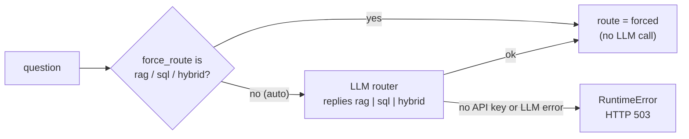
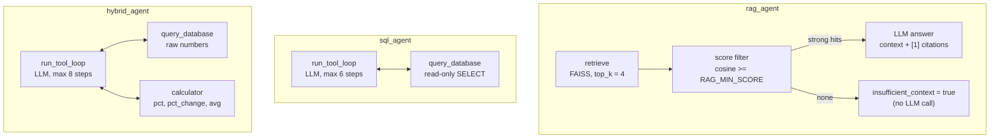

<div align="center">

# دستیار هوش مصنوعی Adan

**یک دستیار چند‌عاملی که پاسخ را از اسناد شرکت (RAG)، از پایگاه‌داده (NL2SQL) یا از ترکیب هر دو می‌گیرد و محاسبات را با یک ابزار ماشین‌حساب امن انجام می‌دهد.**


</div>

<div align="center">

🌐 [English](README.md) · **فارسی**

</div>

<!--
  ویدئوی دمو (بخش «ویدئوی دمو» را در پایین ببینید)
  ساده‌ترین راه: این فایل را در ویرایشگر وب گیتهاب باز کنید، فایل mp4 را داخل ویرایشگر بکشید و رها کنید
  تا گیتهاب یک لینک https://github.com/user-attachments/... بسازد. آن لینک را در یک خط جدا
  زیر عنوان «ویدئوی دمو» بگذارید تا به‌صورت پخش‌کننده نمایش داده شود.
-->

---

<div dir="rtl">

## فهرست مطالب

- [معرفی](#معرفی)
- [ویدئوی دمو](#ویدئوی-دمو)
- [امکانات](#امکانات)
- [معماری](#معماری)
- [ابزارهای استفاده شده](#ابزارهای-استفاده-شده)
- [شروع سریع](#شروع-سریع)
- [تنظیمات](#تنظیمات)
- [رابط کاربری](#رابط-کاربری)
- [مستندات API](#مستندات-api)
- [نمونه درخواست](#نمونه-درخواست)
- [سناریوهای دمو](#سناریوهای-دمو)
- [امنیت SQL](#امنیت-sql)
- [امتیازدهی RAG](#امتیازدهی-rag)
- [تست](#تست)
- [ساختار پروژه](#ساختار-پروژه)
- [ملاحظات و محدودیت](#ملاحظات-و-محدودیت)
- [مجوز](#مجوز)

</div>

---

<div dir="rtl">

## معرفی

**Adan Retail AI Assistant** یک دستیار داخلی برای فروشگاه فرضی **Adan Retail** است. کارمند فقط سؤال خود را می‌نویسد و سیستم خودش تشخیص می‌دهد پاسخ را باید از کجا بیاورد:

1. **اسناد شرکت (RAG):** سیاست بازگشت کالا، راهنمای کارکنان و کاتالوگ محصولات، همراه با ذکر منبع و شمارهٔ صفحه
2. **پایگاه‌داده (NL2SQL):** سؤال طبیعی به SQL امن و فقط‌خواندنی روی جداول `products` و `sales` تبدیل می‌شود
3. **ترکیب هر دو و محاسبه (Hybrid):** مثلاً «کل درآمد را بگیر و ۱۵٪ آن را حساب کن». مدل با **Tool Calling** اول SQL و سپس ماشین‌حساب را صدا می‌زند

تمرکز پروژه روی **درستی پاسخ، امنیت SQL و قابلیت اجرا با Docker** است، نه ساخت یک محصول Production کامل.

| مسیر | سؤال نمونه | چه اتفاقی می‌افتد |
| --- | --- | --- |
| `rag` | *How many days do customers have to return unused products?* | تکه‌های مرتبط PDF بازیابی می‌شوند و پاسخ با ارجاع `[1]` ساخته می‌شود |
| `sql` | *Show total revenue by category for sales in Tehran* | مدل یک `SELECT` فقط‌خواندنی می‌نویسد، اجرا می‌کند و نتیجه را توضیح می‌دهد |
| `hybrid` | *How much more percent revenue did Tehran make than Isfahan?* | دو بار SQL و سپس `pct_change` در ماشین‌حساب |

</div>

---

<div dir="rtl">

## ویدئوی دمو

</div>

<!-- لینک ویدئوی آپلود شده (آدرس github.com/user-attachments/...) را در خط بعد بگذارید. -->

<!-- اسکرین‌شات اختیاری: آن را در docs/images/ui.png ذخیره کنید و خط بعد را از حالت کامنت خارج کنید.

-->

---

<div dir="rtl">

## امکانات

- **مسیردهی خودکار:** یک router مبتنی بر LLM یکی از `rag`، `sql` یا `hybrid` را انتخاب می‌کند؛ می‌توانید مسیر را دستی هم تعیین کنید.
- **پاسخ مستند:** پاسخ‌های RAG سند و صفحهٔ منبع را ذکر می‌کنند. اگر بازیابی ضعیف باشد، API به‌جای حدس‌زدن می‌گوید زمینه کافی نیست (`insufficient_context=true`).
- **NL2SQL امن:** چهار لایهٔ مستقل (validator، اتصال فقط‌خواندنی، authorizer در SQLite، محدودیت زمان و تعداد ردیف). بخش [امنیت SQL](#امنیت-sql) را ببینید.
- **Tool Calling واقعی:** `query_database` و `calculator` ابزارهای LangChain هستند. LLM خطای ابزار را می‌بیند و می‌تواند کوئری خودش را اصلاح کند (با سقف تعداد مرحله).
- **شفافیت کامل:** هر پاسخ شامل `trace` مرتب‌شده، همهٔ `tool_calls`، `sql` تولیدشده، نتیجهٔ آن و `sources` است.
- **رابط وب:** رابط Gradio فارسی (RTL) با نمایش ردپای agent، منابع، جدول نتیجهٔ SQL و نشانگر زندهٔ وضعیت اتصال.
- **اجرا با یک دستور:** Docker Compose پایگاه‌داده را می‌سازد، ایندکس برداری را می‌سازد و هم API و هم UI را بالا می‌آورد.

</div>

---

<div dir="rtl">

## معماری

### ۱. گراف Coordinator (با LangGraph)

یک router و سه نود تخصصی؛ هر سه نود مستقیم به `END` می‌روند و گراف حلقه ندارد (کد: `app/agents/coordinator.py`).

</div>


<div dir="rtl">

### ۲. router چگونه تصمیم می‌گیرد

</div>



<div dir="rtl">

عمداً هیچ fallback مبتنی بر کلمات کلیدی وجود ندارد، چون یک حدس اشتباه بی‌سروصدا پاسخ بی‌ربط می‌دهد. به‌جای آن، نبودن کلید API یا شکست در فراخوانی router به‌صورت خطا گزارش می‌شود.

### ۳. درون هر agent

</div>



<div dir="rtl">

`sql_agent` و `hybrid_agent` هر دو از یک حلقهٔ tool calling مشترک (`app/agents/tool_agent.py`) استفاده می‌کنند: LLM ابزار را صدا می‌زند، نتیجه (یا خطا) را می‌بیند، در صورت نیاز دوباره تلاش می‌کند و در پایان پاسخ می‌دهد. تعداد مرحله‌ها محدود است (`SQL_AGENT_MAX_STEPS` و `HYBRID_AGENT_MAX_STEPS`).

یک راهنمای فارسی مفصل‌تر از کد در [`docs/architecture.html`](docs/architecture.html) است (فایل را دانلود کنید و در مرورگر باز کنید).

</div>

---

<div dir="rtl">

## ابزارهای استفاده شده

| لایه | انتخاب |
| --- | --- |
| API | FastAPI |
| Orchestration | LangGraph (برای router) و حلقهٔ tool calling (`bind_tools`) |
| پایگاه برداری | FAISS |
| Embedding | ‏`sentence-transformers/all-MiniLM-L6-v2` (محلی، بدون نیاز به کلید API) |
| LLM | ‏OpenAI یا Gemini، هر دو از طریق `ChatOpenAI`؛ مدل **باید از tool calling پشتیبانی کند** |
| پایگاه‌داده | SQLite (‏`products` و `sales`) |
| آماده‌سازی PDF | ‏pypdf و پیش‌پردازش (حذف header/footer، اصلاح خط‌تیره، Unicode NFKC، chunking) |
| رابط کاربری | Gradio (راست‌چین، تم تیره) |
| بسته‌بندی | Docker و Docker Compose |

</div>

---

<div dir="rtl">

## شروع سریع

### Docker (پیشنهادی)

</div>

```bash
cp .env.example .env
# فایل .env را ویرایش کنید: OPENAI_API_KEY (و در صورت استفاده از gateway، OPENAI_BASE_URL)
# یا LLM_PROVIDER=gemini و GEMINI_API_KEY را تنظیم کنید

docker compose up --build
```

<div dir="rtl">

| سرویس | آدرس |
| --- | --- |
| رابط کاربری (Gradio) | http://localhost:7860 |
| API | http://localhost:8000 |
| مستندات تعاملی API (Swagger) | http://localhost:8000/docs |

هنگام شروع، کانتینر `assistant` این کارها را انجام می‌دهد:

1. پایگاه‌دادهٔ SQLite را می‌سازد و داده‌ها را وارد می‌کند
2. ایندکس FAISS را می‌سازد (در اولین اجرا مدل embedding دانلود می‌شود، پس ممکن است چند دقیقه طول بکشد)
3. Uvicorn را روی پورت `8000` اجرا می‌کند

کانتینر `ui` بعد از اینکه API سالم گزارش شد بالا می‌آید. PDFهای نمونه از قبل در `data/documents/` هستند.

### اجرای محلی (بدون Docker)

</div>

```bash
python -m venv .venv
# Windows: .venv\Scripts\activate
# Linux/macOS: source .venv/bin/activate
pip install -r requirements.txt
cp .env.example .env   # کلید API را اضافه کنید

python scripts/init_db.py
python scripts/build_index.py
uvicorn app.main:app --reload --port 8000
```

<div dir="rtl">

در یک ترمینال دیگر رابط کاربری را اجرا کنید:

</div>

```bash
python ui/gradio_app.py        # http://127.0.0.1:7860
```

<div dir="rtl">

### تغییر اسناد

ایندکس FAISS از `data/documents/*.pdf` و با `scripts/build_index.py` ساخته می‌شود (Docker آن را در هر بار شروع کانتینر اجرا می‌کند). بعد از افزودن یا ویرایش یک PDF، این اسکریپت را دوباره اجرا کنید و API را restart کنید، چون API ایندکس را در حافظه نگه می‌دارد:

</div>

```bash
python scripts/build_index.py
```

---

<div dir="rtl">

## تنظیمات

همهٔ تنظیمات متغیر محیطی هستند (از `.env` خوانده می‌شوند).

| متغیر | پیش‌فرض | کاربرد |
| --- | --- | --- |
| `LLM_PROVIDER` | `openai` | ‏`openai` یا `gemini` |
| `OPENAI_API_KEY` | | کلید OpenAI یا gateway سازگار با OpenAI |
| `OPENAI_BASE_URL` | | آدرس پایهٔ اختیاری سازگار با OpenAI |
| `GEMINI_API_KEY` | | کلید Gemini (از endpoint سازگار با OpenAI گوگل استفاده می‌کند) |
| `LLM_MODEL` | `gpt-4o-mini` | نام مدل چت؛ باید tool calling را پشتیبانی کند |
| `LLM_TIMEOUT`، `LLM_MAX_RETRIES` | ‏`60`، `2` | زمان انتظار هر درخواست (ثانیه) و تعداد تلاش دوباره |
| `EMBEDDING_MODEL` | `sentence-transformers/all-MiniLM-L6-v2` | مدل embedding محلی |
| `RAG_TOP_K` | `4` | تعداد تکه‌های بازیابی‌شده برای هر سؤال |
| `RAG_MIN_SCORE` | `0.30` | آستانهٔ شباهت کسینوسی (بخش [امتیازدهی RAG](#امتیازدهی-rag)) |
| `SQL_MAX_ROWS` | `50` | سقف تعداد ردیف هر کوئری |
| `SQL_TIMEOUT_SECONDS` | `5` | محدودیت زمان هر کوئری |
| `SQL_AGENT_MAX_STEPS` | `6` | سقف مراحل حلقهٔ ابزار برای `sql_agent` |
| `HYBRID_AGENT_MAX_STEPS` | `8` | سقف مراحل حلقهٔ ابزار برای `hybrid_agent` |
| `LOG_LEVEL` | `INFO` | سطح logging |

متغیرهای مخصوص UI: ‏`ASSISTANT_API_URL` (پیش‌فرض `http://127.0.0.1:8000`)، `GRADIO_SERVER_NAME` و `GRADIO_SERVER_PORT`.

> [!NOTE]
> فایل `.env` را هرگز commit نکنید. این فایل در `.gitignore` هست و فقط `.env.example` باید در مخزن باشد.

</div>

---

<div dir="rtl">

## رابط کاربری

بعد از `docker compose up` آدرس http://localhost:7860 را باز کنید.

- **چت:** سؤال بپرسید و کارت پاسخ را با نشان مسیر و وضعیت زمینه ببینید.
- **انتخاب مسیر:** روی `auto` بگذارید یا یکی از `rag`، `sql` یا `hybrid` را اجباری کنید.
- **تب Agent Trace:** مراحل مرتب‌شدهٔ اجرا (coordinator، agent، ابزارها) همراه با داده‌هایشان.
- **تب منابع:** اسناد استناد‌شده با شمارهٔ صفحه، امتیاز شباهت و گزیده‌ی متن.
- **بلوک SQL و محاسبه:** کوئری تولیدشده، نتیجه‌ی آن به‌صورت جدول، و محاسبه.
- **نشانگر وضعیت:** از `/health` می‌خواند و آمادگی DB، RAG و LLM را نشان می‌دهد.
- **دکمه‌های نمونه:** با یک کلیک سؤال و مسیر نمونه پر می‌شود.

اسناد ایندکس‌شده انگلیسی هستند، پس سؤال‌های مربوط به اسناد را انگلیسی بپرسید (بخش [ملاحظات و محدودیت](#ملاحظات-و-محدودیت)).

</div>

---

<div dir="rtl">

## مستندات API

| متد | مسیر | توضیح |
| --- | --- | --- |
| `GET` | `/health` | آمادگی پایگاه‌داده، ایندکس RAG و پیکربندی LLM |
| `POST` | `/ask` | پرسیدن سؤال |
| `POST` | `/sql/validate?sql=...` | ‏endpoint نمایشی: validator امنیتی SQL را اجرا می‌کند (بدون LLM) |

### ‏`POST /ask`

درخواست:

</div>

```json
{ "question": "What is the total sales revenue and calculate 15 percent of that amount?",
  "force_route": "hybrid" }
```

<div dir="rtl">

طول `question` بین ۱ تا ۲۰۰۰ کاراکتر است. مقدار `force_route` می‌تواند `auto` (پیش‌فرض)، `rag`، `sql` یا `hybrid` باشد.

پاسخ (خلاصه‌شده و نمونه):

</div>

```json
{
  "answer": "Total revenue is 3944.15; 15% of that is 591.62.",
  "route": "hybrid",
  "sql": "SELECT SUM(quantity * unit_price) AS total_revenue FROM sales",
  "sql_result": [{ "total_revenue": 3944.15 }],
  "calculator": { "expression": "3944.15 * 15 / 100", "result": 591.6225 },
  "tool_calls": [
    { "tool": "query_database", "arguments": { "sql": "SELECT ..." }, "ok": true },
    { "tool": "calculator", "arguments": { "expression": "3944.15 * 15 / 100" }, "ok": true }
  ],
  "trace": [
    { "component": "coordinator", "detail": "..." },
    { "component": "hybrid_agent", "detail": "..." }
  ],
  "sources": [],
  "insufficient_context": false
}
```

<div dir="rtl">

| فیلد | معنی |
| --- | --- |
| `answer` | پاسخ نهایی به زبان طبیعی |
| `route` | کدام agent سؤال را پردازش کرد |
| `sources` | ارجاع‌های RAG: ‏`document`، `page`، `score`، `excerpt` |
| `sql`، `sql_result` | کوئری تولیدشده و ردیف‌های آن (مسیرهای SQL و hybrid) |
| `calculator` | آخرین عبارت ماشین‌حساب و نتیجه‌اش |
| `tool_calls` | همهٔ فراخوانی‌های ابزار توسط LLM، با آرگومان، خروجی و خطا |
| `trace` | فهرست مرتب اجزایی که اجرا شدند |
| `insufficient_context` | وقتی بازیابی چیز قابل‌اعتمادی پیدا نکند `true` است |

کدهای وضعیت: ‏`400` سؤال خالی، `503` در دسترس نبودن یا پیکربندی‌نشدن LLM، `500` خطای غیرمنتظره.

</div>

---

<div dir="rtl">

## نمونه درخواست

</div>

```bash
# سلامت
curl http://localhost:8000/health

# RAG
curl -s http://localhost:8000/ask -H "Content-Type: application/json" \
  -d '{"question":"How many days do customers have to return unused products?","force_route":"rag"}'

# NL2SQL: تجمیع
curl -s http://localhost:8000/ask -H "Content-Type: application/json" \
  -d '{"question":"What is the total revenue from all sales?","force_route":"sql"}'

# NL2SQL: فیلتر و join
curl -s http://localhost:8000/ask -H "Content-Type: application/json" \
  -d '{"question":"Show total revenue by category for sales in Tehran","force_route":"sql"}'

# Hybrid: اول SQL بعد ماشین‌حساب
curl -s http://localhost:8000/ask -H "Content-Type: application/json" \
  -d '{"question":"What is the total sales revenue and calculate 15 percent of that amount?","force_route":"hybrid"}'

# Hybrid چندکوئری: دو SQL و سپس درصد تغییر
curl -s http://localhost:8000/ask -H "Content-Type: application/json" \
  -d '{"question":"How much more percent revenue did Tehran make than Isfahan?","force_route":"hybrid"}'

# سؤال خارج از دامنهٔ اسناد (نباید چیزی از خودش بسازد)
curl -s http://localhost:8000/ask -H "Content-Type: application/json" \
  -d '{"question":"What is the CEO private phone number?","force_route":"rag"}'

# SQL خطرناک (مسدود می‌شود، بدون LLM)
curl -s -X POST "http://localhost:8000/sql/validate?sql=DROP%20TABLE%20products"
```

<div dir="rtl">

در Windows PowerShell به‌جای این دستورهای `curl` از UI یا Swagger در `/docs` استفاده کنید (قواعد quote متفاوت است).

نمونه‌های بیشتر: [`examples/sample_requests.md`](examples/sample_requests.md) · خروجی‌های نمونه: [`examples/sample_outputs.json`](examples/sample_outputs.json)

</div>

---

<div dir="rtl">

## سناریوهای دمو

| # | نوع | سؤال نمونه | رفتار مورد انتظار |
| --- | --- | --- | --- |
| ۱ | RAG | مهلت بازگشت کالاهای استفاده‌نشده؟ | حدود ۳۰ روز، منبع `return_policy.pdf` |
| ۲ | RAG | مرخصی سالانهٔ کارمندان تمام‌وقت؟ | ۱۸ روز، منبع `employee_handbook.pdf` |
| ۳ | RAG خارج از دامنه | حقوق مدیرعامل یا تلفن شخصی او؟ | ‏`insufficient_context=true` و بدون توهم |
| ۴ | NL2SQL | کل درآمد فروش؟ | ‏`SUM(quantity * unit_price)` و ردیف‌ها |
| ۵ | NL2SQL | درآمد هر دسته‌بندی در تهران؟ | ‏JOIN و GROUP BY و فیلتر |
| ۶ | Hybrid | کل درآمد و ۱۵٪ آن؟ | ‏`query_database` سپس `calculator` در `trace` و `tool_calls` |
| ۷ | Hybrid | مقایسهٔ درآمد تهران و اصفهان، درصد اختلاف؟ | دو بار `query_database` سپس `calculator` (‏`pct_change`) |
| ۸ | امنیت SQL | ‏`DROP TABLE products` | توسط validator رد می‌شود |
| ۹ | اصلاح خودکار SQL | کوئری با ستون اشتباه | خطا به LLM برمی‌گردد و کوئری اصلاح می‌شود (‏`tests/test_tool_agent.py`) |

### داده‌های نمونه

جدول `products` (۶ ردیف در دسته‌های Electronics، Stationery و Accessories) و `sales` (۱۵ ردیف، از ژانویه تا مارس ۲۰۲۵، مناطق Tehran، Isfahan، Shiraz و Mashhad). درآمد هر ردیف فروش برابر `quantity * unit_price` است. بازسازی با `python scripts/init_db.py`.

</div>

---

<div dir="rtl">

## امنیت SQL

SQL تولیدشده توسط LLM از چند لایهٔ مستقل می‌گذرد که هر کدام به‌تنهایی جلوی نوشتن را می‌گیرد:

1. **Validator** (‏`validate_readonly_sql`): فقط یک statement، فقط `SELECT` یا `WITH`، و کلمات DDL/DML مسدود هستند. رشته‌ها و کامنت‌ها نادیده گرفته می‌شوند، پس `LIKE '%update%'` و `REPLACE()` مشکلی ندارند.
2. **اتصال فقط‌خواندنی:** فایل SQLite با `mode=ro` و `PRAGMA query_only=ON` باز می‌شود.
3. **Authorizer** (‏`set_authorizer`): فقط `SELECT`، فراخوانی تابع و خواندن از `products` و `sales` مجاز است؛ `sqlite_master`، `ATTACH`، `PRAGMA` و هر نوشتنی توسط خود SQLite رد می‌شود.
4. **محدودیت‌ها:** ‏`SQL_TIMEOUT_SECONDS` برای زمان هر کوئری و `SQL_MAX_ROWS` برای تعداد ردیف.

خطاها به‌صورت نتیجهٔ ابزار به LLM برمی‌گردند تا کوئری خودش را اصلاح کند (با سقف تعداد مرحله). ماشین‌حساب هم ایزوله است: یک AST محدود را ارزیابی می‌کند (عملیات حسابی و توابع `abs`، `round`، `min`، `max`، `sqrt`، `pct`، `pct_change` و `avg`) و هرگز از `eval` استفاده نمی‌کند.

</div>

---

<div dir="rtl">

## امتیازدهی RAG

FAISS مجذور فاصلهٔ L2 را برمی‌گرداند. چون embeddingها نرمال هستند، کد آن را به **شباهت کسینوسی** تبدیل می‌کند (‏`1 - d/2`). تکه‌هایی که از `RAG_MIN_SCORE` کمتر باشند نادیده گرفته می‌شوند. اگر هیچ تکه‌ای نماند، API با `insufficient_context=true` پاسخ می‌دهد و LLM را صدا نمی‌زند.

بهترین آستانه به اسناد و مدل embedding شما بستگی دارد. با این دستور آن را کالیبره کنید:

</div>

```bash
python scripts/check_rag_threshold.py
```

---

<div dir="rtl">

## تست

</div>

```bash
pytest -q
```

<div dir="rtl">

برای تست‌ها کلید API لازم نیست؛ LLM با یک نمونهٔ ساختگی با سناریوی از پیش‌تعیین‌شده جایگزین می‌شود. موارد پوشش‌داده‌شده:

- ایمنی و توابع کمکی ماشین‌حساب
- اعتبارسنجی SQL، اتصال فقط‌خواندنی، authorizer، timeout و سقف ردیف
- agentهای tool calling: پاسخ SQL، خطای SQL و تلاش دوباره، SQL و سپس ماشین‌حساب، hybrid چندکوئری، سقف مراحل
- فیلدهای پاسخ `/ask` برای مسیر hybrid به‌صورت end-to-end
- پیش‌پردازش و chunking اسناد
- مسیردهی coordinator (router مبتنی بر LLM، مسیر اجباری، خطا وقتی کلید نیست یا LLM شکست می‌خورد)

</div>

---

<div dir="rtl">

## ساختار پروژه

</div>

```
app/
  main.py                 # FastAPI app: /health, /ask, /sql/validate
  config.py               # settings from environment
  llm.py                  # one place to build the chat model (OpenAI / Gemini)
  agents/
    coordinator.py        # LangGraph router + nodes
    tool_agent.py         # shared tool-calling loop (bind_tools, retries, step limit)
    sql_agent.py          # query_database tool
    hybrid_agent.py       # query_database + calculator tools
    rag_agent.py
  rag/                    # preprocess, ingest (FAISS), retrieve + answer
  sql/                    # schema/seed, read-only connection, validation/execution
  tools/
    calculator.py         # AST-based safe calculator (+ LangChain tool)
    database.py           # query_database LangChain tool
  models/schemas.py       # request/response models
ui/
  gradio_app.py           # Gradio frontend
  assets/style.css        # UI theme (dark, RTL)
data/
  documents/              # sample PDFs
  db/                     # SQLite file (generated)
  faiss_index/            # vector index (generated)
docs/architecture.html    # Persian code walkthrough
examples/                 # sample requests and outputs
scripts/                  # init_db, build_index, check_rag_threshold, entrypoint
tests/
Dockerfile
docker-compose.yml
.env.example
```

---

<div dir="rtl">

## ملاحظات و محدودیت

- آمادهٔ Production نیست: احراز هویت، rate limiting و جداسازی چندمستأجری ندارد؛ `/sql/validate` فقط یک endpoint نمایشی است.
- مدل پیکربندی‌شده باید tool calling را پشتیبانی کند و کیفیت پاسخ به مدل بستگی دارد.
- router فقط یک بار LLM را صدا می‌زند و بعد از پایان کار agent دوباره مسیر را عوض نمی‌کند. بدون کلید API (یا در صورت شکست آن فراخوانی) `/ask` خطای `503` می‌دهد، مگر اینکه `force_route` تعیین شده باشد و agent انتخاب‌شده بدون LLM هم بتواند اجرا شود.
- ‏Embedding انگلیسی (MiniLM): سؤال‌های غیرانگلیسی روی PDFهای انگلیسی ضعیف بازیابی می‌شوند.
- پایگاه‌دادهٔ SQLite نمونه کوچک و ثابت است.
- با تغییر PDFها ایندکس FAISS خودکار بازسازی نمی‌شود (بخش [تغییر اسناد](#تغییر-اسناد)).

</div>

---

<div dir="rtl">

## مجوز

این پروژه به‌عنوان یک نمونهٔ ارزیابی برای تکلیف Adan RAG تهیه شده است.

</div>
